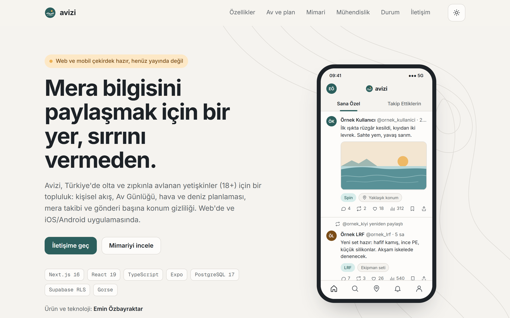
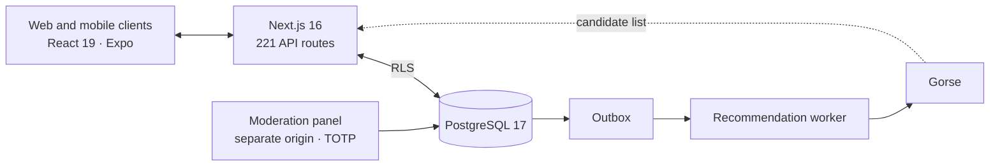

# Avizi

[Türkçe](README.md) · **English**

A community platform for adults (18+) in Turkey who fish with rod and line or spearfish. Personalized feed, catch log, weather and sea planning, fishing spot tracking and per-post location privacy, on the web and in an iOS/Android app.

**Showcase:** [lightwonkas.github.io/avizi-showcase](https://lightwonkas.github.io/avizi-showcase/)

<picture>
  <source media="(prefers-color-scheme: dark)" srcset="docs/preview-dark.png">
  
</picture>

> **Status:** The web and mobile core is built; the product is not live yet, and the next steps depend on external accounts. The application source code is in a private repository; this repository contains the showcase page only.

## Stack

| Layer | Components |
|---|---|
| Web | Next.js 16 · React 19 · TypeScript |
| Mobile | Expo (React Native) · iOS and Android |
| Data | Supabase — PostgreSQL 17, Auth, Storage, Row Level Security |
| Recommendations | Gorse · outbox-driven sync worker |
| Weather | Open-Meteo forecasts, stored as immutable snapshots |
| Moderation | Panel on a separate origin, mandatory TOTP, audit log |
| Compliance | KVKK (Turkish data protection law): data export, account deletion with a 14-day grace period; access log under Law No. 5651 |
| Experimentation | A/B framework — sticky assignment, per-experiment kill switch |

## Features

- **Catch log:** quick and detailed entries; rod fields for tackle and line, spearfishing fields for depth, bottom time and visibility; blank sessions count too. An entry stays private or becomes a post.
- **Weather and sea planning:** wind, waves, pressure and moon phase; a saved plan keeps an immutable copy of the forecast it was made with.
- **Offline logging:** entries queue on the device and sync once a connection is back; on a conflict the server never silently overwrites.
- **Location privacy:** four levels — exact, approximate (~3 km, H3 res 6), regional (province/district) and hidden. EXIF location data is stripped from photos.
- **Species catalog and official regulations:** warnings for closed seasons and undersized catches; rules are only published after being checked against the official text.
- **Community spot insights:** shown only with ≥ 30 entries from ≥ 5 people where no single person holds more than 40%; users can opt out.
- **Personal insights, knowledge center, points, public post pages, business profiles and directory.**
- **Plans:** Freemium, Premium, Creator and Commercial, backed by a single entitlement layer.

Features waiting on an external account or a founder decision ship behind a disabled flag.

## Architecture

The recommendation engine only proposes candidates; visibility is always decided in the database through RLS policies. Access control lives in a single layer that the recommendation service cannot bypass.

### Feed pipeline — home-v1.1.0

| Stage | Function |
|---|---|
| Candidate generation | Merges follows, reposts, trending, low-exposure content and Gorse |
| Eligibility | Every candidate passes visibility rules regardless of its source |
| Ranking | Scoring followed by diversity-aware reranking |
| Pagination | Stored slate with a signed cursor; no duplicates or drift between pages |
| Delivery | Delivery and exposure logging written in a single transaction |
| Impression | Qualified impression threshold: ≥ 50% visible for ≥ 1 s |

The V1.2 ranking formula (interest, freshness, author score; 10–20% exploration) is ready as the draft version `home-v1.3.0`, behind a disabled flag.

## Engineering

| Metric | Value |
|---|---|
| Database migrations | 315 |
| pgTAP SQL test files | 175 |
| Application test files (web and mobile) | 461 |
| API routes | 221 |

- **UI principle:** no fake data and no fake success states; disabled features are shown as unavailable, with the reason.
- **Accessibility:** 44 px minimum touch targets, full keyboard support, light/dark themes, `prefers-reduced-motion`.

## Roadmap

1. App store and sign-in provider accounts (Apple, Google Play, Sign in with Google and Apple; domain and email)
2. Legal documents
3. Hosting (Hetzner) and backups
4. Observability: error tracking and product analytics
5. Mobile closed testing: 12 testers for 14 days on Google Play, TestFlight on iOS
6. Closed beta

## Team

| | |
|---|---|
| **Emin Özbayraktar** | Co-founder — Product & Technology |
| **Arda Burak Akalın** | Co-founder — Growth & Community |

## Contact

[emin.ozbayraktarr@gmail.com](mailto:emin.ozbayraktarr@gmail.com) · [LinkedIn](https://www.linkedin.com/in/emin-ozbayraktar) · [GitHub](https://github.com/lightwonkas)

---

© 2026 Avizi. All rights reserved.
