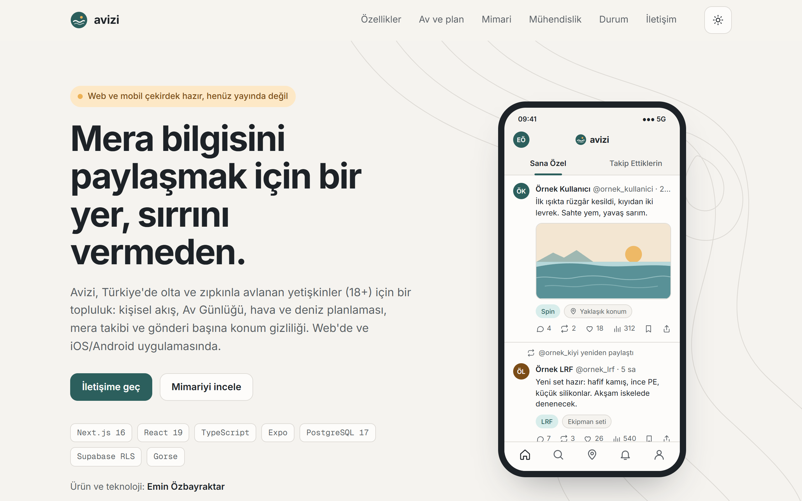
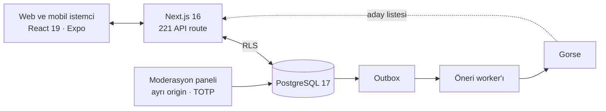

# Avizi

**Türkçe** · [English](README.en.md)

Türkiye'de olta ve zıpkınla avlanan yetişkinler (18+) için topluluk platformu. Kişisel akış, Av Günlüğü, hava ve deniz planlaması, mera takibi ve gönderi başına konum gizliliği; web'de ve iOS/Android uygulamasında.

**Vitrin:** [lightwonkas.github.io/avizi-showcase](https://lightwonkas.github.io/avizi-showcase/)

<picture>
  <source media="(prefers-color-scheme: dark)" srcset="docs/preview-dark.png">
  
</picture>

> **Durum:** Web ve mobil çekirdek hazır; yayında değil. Sıradaki adımlar dış hesaplara bağlı. Uygulama kaynak kodu özel depodadır; bu depo yalnızca vitrin sayfasını içerir.

## Teknoloji

| Katman | Bileşen |
|---|---|
| Web | Next.js 16 · React 19 · TypeScript |
| Mobil | Expo (React Native) · iOS ve Android |
| Veri | Supabase — PostgreSQL 17, Auth, Storage, Row Level Security |
| Öneri | Gorse · outbox tabanlı senkronizasyon worker'ı |
| Hava | Open-Meteo tahmini, değişmez anlık kayıt |
| Moderasyon | Ayrı origin üzerinde panel, zorunlu TOTP, denetim kaydı |
| Uyum | KVKK: veri dışa aktarma, 14 günlük askılı hesap silme; 5651 erişim kaydı |
| Deney | A/B altyapısı — sticky atama, deney başına kill switch |

## Özellikler

- **Av Günlüğü:** temel ve ayrıntılı kayıt; oltada takım ve misina, zıpkında derinlik, dip süresi ve görüş alanları; boş dönüş de kaydedilir. Kayıt gizli kalabilir ya da gönderiye dönüşür.
- **Hava ve deniz planlama:** rüzgâr, dalga, basınç ve ay evresi; kaydedilen plan tahminin değişmez bir kopyasını tutar.
- **Çevrimdışı kayıt:** kayıt cihazda kuyruğa girer, bağlantı gelince senkronlanır; çakışmada sunucu sessizce üzerine yazmaz.
- **Konum gizliliği:** dört seviye — kesin, yaklaşık (~3 km, H3 res 6), bölgesel (il/ilçe), gizli. Fotoğraflardaki EXIF konum bilgisi silinir.
- **Tür kataloğu ve Tebliğ kuralları:** yasak dönem ve asgari boy uyarısı; kurallar resmî metinle doğrulanmadan yayımlanmaz.
- **Topluluk mera analizi:** yalnız ≥ 30 kayıt, ≥ 5 kişi ve tek kişinin payı ≤ %40 olduğunda; katılmamak mümkün.
- **Kişisel analiz, Bilgi Merkezi, puan sistemi, herkese açık gönderi sayfası, işletme vitrini ve dizini.**
- **Paketler:** Freemium, Premium, Creator ve Ticari; haklar tek katmanda tutulur.

Dış hesap ya da kurucu kararı bekleyen özellikler kapalı bayrakla gelir.

## Mimari

Öneri motoru yalnızca aday üretir; görünürlük kararı her durumda veritabanında RLS politikalarıyla verilir. Erişim kontrolü tek bir katmanda toplanır ve öneri servisi bu sınırı aşamaz.

### Akış hattı — home-v1.1.0

| Aşama | İşlev |
|---|---|
| Aday üretimi | Takip, yeniden paylaşım, trend, düşük gösterimli içerik ve Gorse kaynaklarının birleştirilmesi |
| Uygunluk | Tüm adayların kaynaktan bağımsız olarak görünürlük kurallarından geçirilmesi |
| Sıralama | Skorlama ve çeşitlilik odaklı yeniden sıralama |
| Sayfalama | Saklanan slate ve imzalı cursor; sayfalar arası tekrar veya kayma yok |
| Teslimat | Teslimat ve exposure kaydının tek transaction içinde yazılması |
| Gösterim | Nitelikli gösterim eşiği: ≥ %50 görünürlük, ≥ 1 sn |

V1.2 sıralama formülü (ilgi, tazelik, yazar puanı; %10–20 keşif payı) taslak sürüm `home-v1.3.0` olarak hazır, bayrakla kapalı.

## Mühendislik

| Metrik | Değer |
|---|---|
| Veritabanı migration'ı | 315 |
| pgTAP SQL test dosyası | 175 |
| Uygulama test dosyası (web ve mobil) | 461 |
| API route | 221 |

- **Arayüz ilkesi:** sahte veri ve sahte başarı durumu gösterilmez; devre dışı özellikler kapalı ve gerekçesiyle görünür.
- **Erişilebilirlik:** 44 px minimum dokunma alanı, tam klavye desteği, açık/koyu tema, `prefers-reduced-motion`.

## Yol haritası

1. Mağaza ve giriş sağlayıcı hesapları (Apple, Google Play, Google ve Apple ile giriş; alan adı ve e-posta)
2. Hukuk metinleri
3. Sunucu (Hetzner) ve yedek
4. Gözlem: hata takibi ve ürün analitiği
5. Mobil kapalı test: Google Play'de 12 testçi × 14 gün, TestFlight
6. Kapalı beta

## Ekip

| | |
|---|---|
| **Emin Özbayraktar** | Kurucu ortak — Ürün ve Teknoloji |
| **Arda Burak Akalın** | Kurucu ortak — Büyüme ve Topluluk |

## İletişim

[emin.ozbayraktarr@gmail.com](mailto:emin.ozbayraktarr@gmail.com) · [LinkedIn](https://www.linkedin.com/in/emin-ozbayraktar) · [GitHub](https://github.com/lightwonkas)

---

© 2026 Avizi. Tüm hakları saklıdır.
